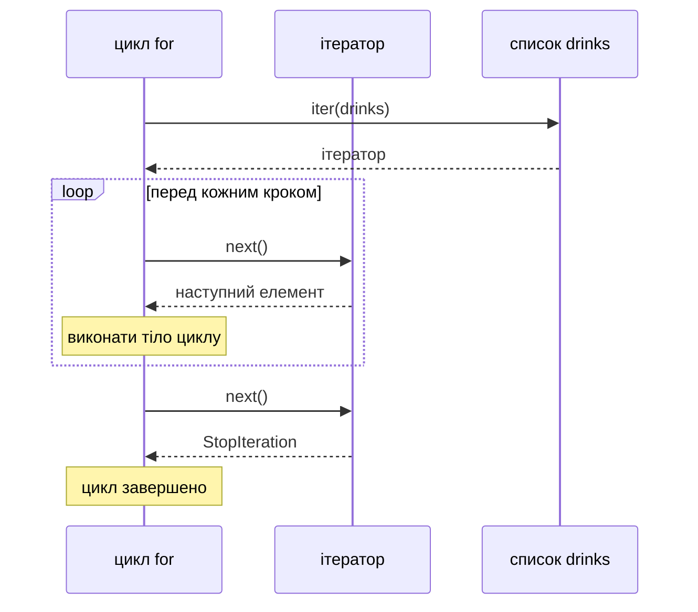
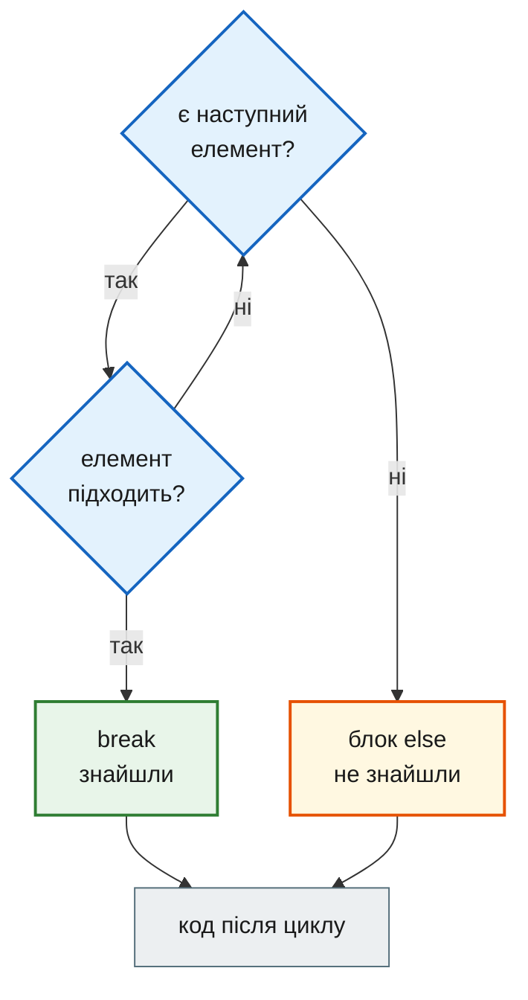
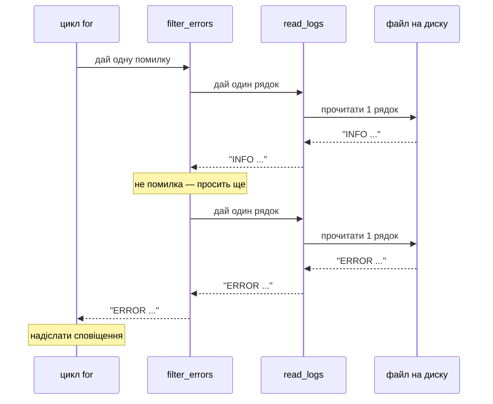
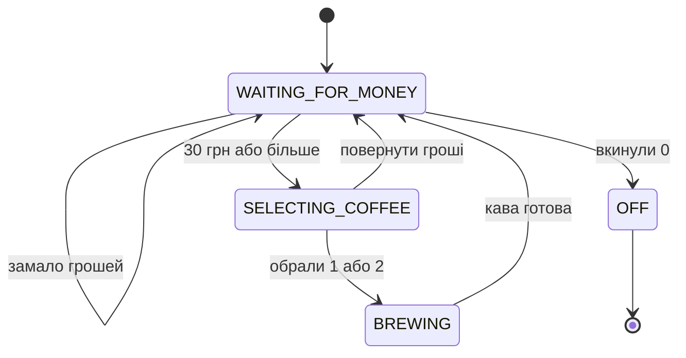
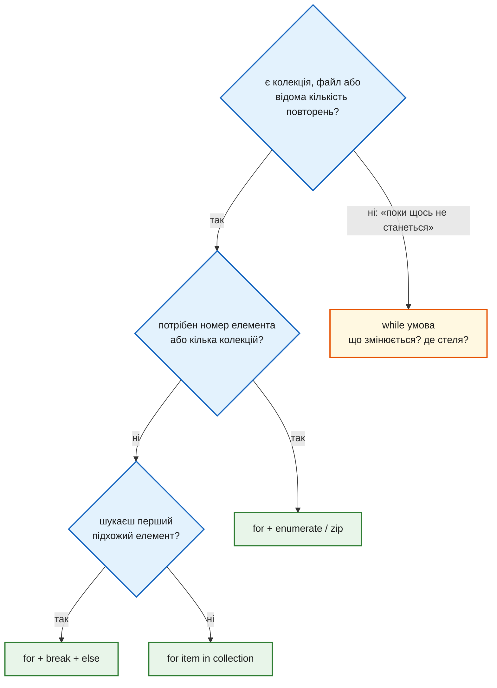

# Бонус. Два цикли Python: for і while

В уроці 4 ти писав `while`, в уроці 6 — `for`. Обидва повторюють дії, і перший час здається, що різниця лише в записі. Насправді в кожного своя робота:

- **`for`** бере щось, що вміє віддавати елементи по одному, і проходить по ньому до кінця;
- **`while`** повторює дії, поки умова істинна, і нічого не знає про жодні елементи.

Цей бонус-урок (поза нумерацією 1–53) збирає все про цикли в одному місці й вчить **обирати** цикл під задачу. Перші шість розділів — основа, доступна одразу після уроку 6. Розділ [«Чотири архітектурні патерни»](#patterns) спирається на функції й генератори — до нього зручно повернутися після уроку 11.

| Крок | Матеріал | Що вчимо |
|---|---|---|
| 1 | [`loops_for_while_docs.ipynb`](https://github.com/NikoriakViktor/PY-Course-Victor-Nikoriak-11-11-2026/blob/main/module_1/bonus/loops_for_while_docs.ipynb) [](https://colab.research.google.com/github/NikoriakViktor/PY-Course-Victor-Nikoriak-11-11-2026/blob/main/module_1/bonus/loops_for_while_docs.ipynb) | усі приклади цієї сторінки без готового виводу — спершу прогноз, потім запуск; 7 завдань із розв’язками наприкінці |
| 2 | ця сторінка | пояснення, вивід кожного прикладу, схеми |

**Що потрібно з попередніх уроків:** `if` і `while` ([урок 4](lesson_04.md)), списки ([урок 5](lesson_05.md)), словники й `for` ([урок 6](lesson_06.md)). Для розділу про патерни — функції ([урок 8](lesson_08.md)) і генератори ([урок 11](lesson_11.md)).

**Після уроку ти зможеш:**

- одним реченням пояснити, чому в задачі потрібен саме `for` або саме `while`;
- показати, що `for` робить «під капотом»: `iter()` → `next()` → `StopIteration`;
- написати пошук через `for ... else` без змінної-прапорця;
- впізнати три типові помилки: `range(len(...))`, зміна списку під час обходу, холостий `while True`;
- прочитати й пояснити чотири архітектурні патерни: воркер, конвеєр генераторів, `iter()` з вартовим значенням, кінцевий автомат.

## Пригадай

Дай відповідь подумки, нічого не запускаючи:

1. Що станеться, якщо в циклі `while i < 5:` забути рядок `i += 1`?
2. Що надрукує `for ch in "кава": print(ch)`?
3. Що віддає `for key in {"пт": 2, "сб": 3}:` — ключі, значення чи пари?

??? success "Відповіді"

    1. Умова завжди істинна — цикл не закінчиться.
    2. Чотири рядки, по одній літері: `к`, `а`, `в`, `а`. Рядок теж уміє віддавати елементи по одному.
    3. Лише ключі. Для пар потрібен `.items()`.

## Одна задача — два цикли { #two-loops }

**Задача.** У кав’ярні є чеки за день. Треба порахувати виторг.

```python
checks = [120, 85, 240, 60, 310]

total = 0
for check in checks:
    total += check
    print(f"чек {check:>3} → разом {total}")

print("Виторг:", total)
```

```text
чек 120 → разом 120
чек  85 → разом 205
чек 240 → разом 445
чек  60 → разом 505
чек 310 → разом 815
Виторг: 815
```

Тепер **та сама задача** через `while`. Замість «для кожного чека» пишемо «поки не дійшли до кінця списку»:

```python
total = 0
i = 0                        # 1) самі створили лічильник
while i < len(checks):       # 2) самі перевіряємо межу
    check = checks[i]
    total += check
    print(f"чек {check:>3} → разом {total}")
    i += 1                   # 3) самі рухаємося далі

print("Виторг:", total)
```

Вивід той самий. Але у версії з `while` з’явилися три речі, які ми мусимо зробити **самі**: створити лічильник, перевіряти межу і збільшувати лічильник. Якщо забути `i += 1`, цикл ніколи не закінчиться. У `for` усе це робить Python.

Тепер змінимо задачу так, щоб **списку не було**.

**Задача.** Ти збираєш на навушники 2400 грн і щотижня відкладаєш 350 грн. Через скільки тижнів вистачить?

```python
goal = 2400
saved = 0
weeks = 0

while saved < goal:
    saved += 350
    weeks += 1
    print(f"тиждень {weeks}: накопичено {saved}")

print("Тижнів потрібно:", weeks)
```

```text
тиждень 1: накопичено 350
тиждень 2: накопичено 700
тиждень 3: накопичено 1050
тиждень 4: накопичено 1400
тиждень 5: накопичено 1750
тиждень 6: накопичено 2100
тиждень 7: накопичено 2450
Тижнів потрібно: 7
```

Тут немає колекції, по якій можна пройтися. Кількість кроків — це і є відповідь, яку ми шукаємо, тож заздалегідь її не знаємо. Цикл триває, поки **стан програми** (`saved`) не досягне мети.

!!! note "Правило"
    `for` читається як **«для кожного елемента з …»** — є що перебирати.
    `while` читається як **«поки … істинне»** — є умова, яка колись стане хибною.

??? question "Перевір себе: який цикл природний для кожної задачі?"

    1. Надіслати лист кожному клієнту зі списку.
    2. Питати пароль, поки користувач не введе правильний.
    3. Надрукувати таблицю множення на 7 (від 1 до 10).
    4. Ділити число на 2, поки воно парне.

??? success "Відповідь"

    1 — `for` (є список). 2 — `while` (невідомо, скільки спроб). 3 — `for` з `range(1, 11)` (кількість кроків відома). 4 — `while` (кількість кроків залежить від самого числа).

## Що for робить під капотом { #protocol }

Знайомий код:

```python
drinks = ["еспресо", "лате", "какао"]

for drink in drinks:
    print("готую:", drink)
```

Звідки `for` знає, який елемент наступний і коли зупинитися? Зробимо його роботу **руками**:

- `iter(drinks)` дає **ітератор** — об’єкт, який пам’ятає, де ми зараз у списку;
- `next(it)` видає наступний елемент;
- коли елементи закінчилися, `next` повідомляє про це помилкою `StopIteration`.

`try / except` детально розбирає [урок 14](lesson_14.md). Тут досить читати його так: «спробуй, а якщо сталася саме ця помилка — зроби ось що».

```python
it = iter(drinks)
print("тип:", type(it).__name__)

print("1-й next:", next(it))
print("2-й next:", next(it))
print("3-й next:", next(it))

try:
    print("4-й next:", next(it))
except StopIteration:
    print("4-й next: StopIteration — елементи закінчилися")
```

```text
тип: list_iterator
1-й next: еспресо
2-й next: лате
3-й next: какао
4-й next: StopIteration — елементи закінчилися
```

Тепер зберемо з цих деталей увесь цикл. Цей код робить **точно те саме**, що `for drink in drinks:`.

```python
it = iter(drinks)            # for робить це один раз на початку

while True:
    try:
        drink = next(it)     # for робить це перед кожним кроком
    except StopIteration:
        break                # for тихо завершується
    print("готую:", drink)
```

```text
готую: еспресо
готую: лате
готую: какао
```



Схема показує розподіл ролей: список лише видає ітератор, а далі `for` розмовляє тільки з ним — просить елемент, виконує тіло, просить наступний.

Отже, `for` — це `while`, у якому Python сам бере наступний елемент і сам зупиняється. Саме тому `for` працює з усім, що вміє віддавати елементи по одному: список, рядок, словник, `range`, відкритий файл, генератор.

Ітератор **одноразовий** — він іде тільки вперед:

```python
it = iter(drinks)
print("перший прохід:", list(it))
print("другий прохід:", list(it))    # ітератор уже вичерпано

print("список на місці:", drinks)    # сам список нікуди не дівся
```

```text
перший прохід: ['еспресо', 'лате', 'какао']
другий прохід: []
список на місці: ['еспресо', 'лате', 'какао']
```

!!! note "Правило"
    `for x in щось:` означає: взяти `iter(щось)`, викликати `next()` перед кожним кроком і зупинитися на `StopIteration`.

??? question "Перевір себе: що надрукує цей код?"

    ```python
    it = iter([1, 2, 3])
    next(it)
    for x in it:
        print(x)
    ```

??? success "Відповідь"

    `2` і `3`. Перший елемент уже забрав `next(it)`, а `for` продовжує з того місця, де ітератор зупинився.

## for у роботі { #for-tools }

### Відома кількість повторень — range

```python
for number in range(1, 4):
    print(f"Талон №{number}")
```

```text
Талон №1
Талон №2
Талон №3
```

`range` не створює список чисел — він рахує наступне число лише тоді, коли його просять. Тому мільярд «чисел» займає стільки ж пам’яті, скільки три:

```python
import sys

small = range(3)
huge = range(1_000_000_000)

print(huge)
print("елементів:", len(huge))
print("байтів на range(3):            ", sys.getsizeof(small))
print("байтів на range(1_000_000_000):", sys.getsizeof(huge))
```

```text
range(0, 1000000000)
елементів: 1000000000
байтів на range(3):             48
байтів на range(1_000_000_000): 48
```

### Потрібен номер елемента — enumerate

```python
menu = ["еспресо", "лате", "какао"]

for number, drink in enumerate(menu, start=1):
    print(f"{number}. {drink}")
```

```text
1. еспресо
2. лате
3. какао
```

### Два списки одночасно — zip

```python
names = ["еспресо", "лате", "какао"]
prices = [45, 70, 65]

for name, price in zip(names, prices):
    print(f"{name:<8} {price} грн")
```

```text
еспресо  45 грн
лате     70 грн
какао    65 грн
```

`zip` зупиняється, коли закінчується **коротший** список, — і робить це мовчки:

```python
prices_short = [45, 70]                      # ціну какао загубили

for name, price in zip(names, prices_short):
    print(f"{name:<8} {price} грн")

print("какао зникло без жодної помилки")

try:
    for name, price in zip(names, prices_short, strict=True):   # Python 3.10+
        pass
except ValueError as error:
    print("зі strict=True:", error)
```

```text
еспресо  45 грн
лате     70 грн
какао зникло без жодної помилки
зі strict=True: zip() argument 2 is shorter than argument 1
```

!!! warning "zip мовчки відкидає зайве"
    Якщо списки мають бути однакової довжини, пиши `zip(a, b, strict=True)` — тоді розбіжність стане помилкою, а не загубленими даними.

### Словник — .items()

```python
stock = {"молоко": 12, "зерна": 3, "цукор": 0}

for product, amount in stock.items():
    status = "є" if amount > 0 else "ЗАКІНЧИВСЯ"
    print(f"{product:<7} {amount:>2}  {status}")
```

```text
молоко  12  є
зерна    3  є
цукор    0  ЗАКІНЧИВСЯ
```

!!! note "Правило"
    У `for` ми майже ніколи не рахуємо індекси самі. Потрібен номер — `enumerate`. Два списки — `zip`. Ключ і значення — `.items()`.

??? question "Перевір себе: скільки рядків надрукує цей код?"

    ```python
    for a, b in zip([1, 2, 3, 4], "ab"):
        print(a, b)
    ```

??? success "Відповідь"

    Два: `1 a` і `2 b`. Рядок `"ab"` має лише два символи, а `zip` зупиняється на коротшій послідовності.

## while у роботі { #while-tools }

### Стан змінюється, поки не досягне мети

**Задача.** Знайти найбільший спільний дільник (НСД) чисел 84 і 36 — алгоритм Евкліда. Замінюємо пару `(a, b)` на `(b, остача від a / b)`, поки `b` не стане нулем.

```python
a, b = 84, 36

while b != 0:
    print(f"a = {a:>2}, b = {b:>2}, остача = {a % b}")
    a, b = b, a % b

print("НСД:", a)
```

```text
a = 84, b = 36, остача = 12
a = 36, b = 12, остача = 0
НСД: 12
```

Скільки буде кроків — заздалегідь невідомо: це залежить від самих чисел. Колекції для перебору немає. Це територія `while`.

### Повторні спроби (retry)

**Задача.** Сервер іноді не відповідає. Треба повторювати запит, але **не більше 5 разів**. Справжнього сервера в нас немає, тому `send_request` бере відповіді із заготовленого сценарію.

```python
scripted_answers = iter(["timeout", "timeout", "ok"])


def send_request():
    return next(scripted_answers)


max_attempts = 5
attempt = 0
status = None

while status != "ok" and attempt < max_attempts:
    attempt += 1
    status = send_request()
    print(f"спроба {attempt}: {status}")

if status == "ok":
    print(f"Успіх з {attempt}-ї спроби")
else:
    print("Сервер недоступний, здаємося")
```

```text
спроба 1: timeout
спроба 2: timeout
спроба 3: ok
Успіх з 3-ї спроби
```

В умові **дві** частини: мета (`status != "ok"`) і стеля (`attempt < max_attempts`). Без стелі цикл із сервером, який «лежить», крутився б вічно. У справжньому коді між спробами ще роблять паузу (`time.sleep`), і з кожною спробою вона довшає.

### Черга, яка змінюється під час роботи

**Задача.** Обробляти замовлення з черги, поки вона не спорожніє. Під час обробки можуть з’являтися нові.

```python
from collections import deque

queue = deque(["лате для Олі", "какао для Марка", "еспресо для Іри"])

while queue:                                  # порожня черга — це False
    order = queue.popleft()
    print(f"готую: {order:<28} у черзі ще: {len(queue)}")

    if order == "лате для Олі":
        queue.append("доливка молока для Олі")    # нове замовлення прямо під час роботи

print("Черга порожня:", list(queue))
```

```text
готую: лате для Олі                 у черзі ще: 2
готую: какао для Марка              у черзі ще: 2
готую: еспресо для Іри              у черзі ще: 1
готую: доливка молока для Олі       у черзі ще: 0
Черга порожня: []
```

Тут `for` не підходить: колекція росте й зменшується, поки ми з нею працюємо (чому це проблема для `for` — у розділі [про помилки](#mutation)).

Чому `deque`, а не список? `list.pop(0)` після кожного вилучення зсуває всі інші елементи на одну позицію. `deque.popleft()` просто знімає перший елемент — на довгих чергах різниця величезна.

!!! note "Правило: два запитання до кожного while"
    1. Що змінюється на **кожному** кроці?
    2. Чому через це умова колись **обов’язково** стане хибною?

    Якщо на друге запитання відповіді немає — потрібна стеля: лічильник спроб або тайм-аут.

??? question "Перевір себе: чому цей цикл ніколи не закінчиться?"

    Не запускай — знайди причину очима.

    ```python
    n = 10
    while n != 0:
        n -= 3
    ```

??? success "Відповідь"

    `n` проходить значення 10, 7, 4, 1, −2, −5… і **перестрибує** нуль. Умова `n != 0` лишається істинною назавжди. Надійніше писати `while n > 0:` — така умова стане хибною, навіть якщо точне значення пропущено.

## break, continue та else у циклі { #loop-else }

### continue — пропустити крок, break — вийти з циклу

```python
orders = ["лате", "скасовано", "какао", "зачинено", "еспресо"]

for order in orders:
    if order == "скасовано":
        print("  (пропускаю скасоване)")
        continue                 # одразу до наступного елемента
    if order == "зачинено":
        print("  (кав'ярня зачинилась)")
        break                    # виходимо з циклу зовсім
    print("готую:", order)

print("Цикл завершено")
```

```text
готую: лате
  (пропускаю скасоване)
готую: какао
  (кав'ярня зачинилась)
Цикл завершено
```

### Пошук: спочатку з прапорцем

**Задача.** Чи є серед чеків чек на 500 грн або більше? Якщо є — показати перший. Якщо немає — так і сказати.

```python
checks = [120, 85, 640, 60, 510]

found = False                       # 1) завели прапорець

for check in checks:
    if check >= 500:
        print("Знайшли великий чек:", check)
        found = True                # 2) не забути перемкнути
        break

if not found:                       # 3) окрема перевірка після циклу
    print("Великих чеків немає")
```

```text
Знайшли великий чек: 640
```

Працює, але прапорець доводиться обслуговувати у трьох місцях. Маленька зміна: прибираємо `found` і додаємо до циклу блок `else`. Він стоїть на рівні слова `for`, а не `if`.

```python
checks = [120, 85, 640, 60, 510]

for check in checks:
    if check >= 500:
        print("Знайшли великий чек:", check)
        break
else:
    print("Великих чеків немає")
```

```text
Знайшли великий чек: 640
```

Той самий код на списку, де великих чеків **немає**:

```python
checks = [120, 85, 240, 60, 310]

for check in checks:
    print("перевіряю", check)
    if check >= 500:
        print("Знайшли великий чек:", check)
        break
else:
    print("Великих чеків немає")
```

```text
перевіряю 120
перевіряю 85
перевіряю 240
перевіряю 60
перевіряю 310
Великих чеків немає
```

У першому випадку спрацював `break` — блок `else` пропущено. У другому цикл дійшов до кінця сам — `else` виконався.



Схема показує два виходи з циклу: через `break` — повз `else`, і через «елементи закінчилися» — крізь `else`.

Слово `else` тут збиває з пантелику, бо після `if` воно означає «інакше». У циклі читай його як **«якщо не було `break`»**.

### Те саме для while

**Задача.** Дати користувачеві три спроби ввести пароль. Щоб код запускався без зупинок, паролі беремо зі списку; у справжній програмі на цьому місці стояв би `input("Введіть пароль: ")`.

```python
def login(typed_passwords):
    typed = iter(typed_passwords)
    attempts = 3

    while attempts > 0:
        password = next(typed)          # тут міг би бути input(...)
        if password == "secret":
            print(f"  {password!r}: успішний вхід")
            break
        attempts -= 1
        print(f"  {password!r}: невірно, залишилось спроб: {attempts}")
    else:
        print("  Акаунт заблоковано")


print("Сценарій 1:")
login(["qwerty", "secret"])

print("Сценарій 2:")
login(["qwerty", "12345", "password"])
```

```text
Сценарій 1:
  'qwerty': невірно, залишилось спроб: 2
  'secret': успішний вхід
Сценарій 2:
  'qwerty': невірно, залишилось спроб: 2
  '12345': невірно, залишилось спроб: 1
  'password': невірно, залишилось спроб: 0
  Акаунт заблоковано
```

У сценарії 2 умова `attempts > 0` стала хибною сама — без `break` — тому виконався `else`.

Деталь, яку легко пропустити: якщо цикл **не зробив жодного кроку**, `break` теж не було — отже, `else` виконається.

```python
for check in []:
    print("цей рядок не надрукується")
else:
    print("список порожній, break не було → else виконався")
```

```text
список порожній, break не було → else виконався
```

!!! note "Правило"
    `else` після циклу = **«якщо не було `break`»**. Був `break` → `else` пропускається. Цикл закінчився сам (або навіть не почався) → `else` виконується.

??? question "Перевір себе: що надрукує цей код?"

    ```python
    for n in [2, 4, 6]:
        if n % 2 == 1:
            print("є непарне")
            break
    else:
        print("усі парні")
    ```

??? success "Відповідь"

    `усі парні`. Жодне число не є непарним, `break` не спрацював, цикл дійшов до кінця.

## Три типові помилки { #mistakes }

### Індекси там, де вони не потрібні

```python
menu = ["еспресо", "лате", "какао"]

for i in range(len(menu)):
    print(i + 1, menu[i])
```

Працює, але читач мусить розшифрувати три речі: `range`, `len` і `menu[i]`. А ще тут легко помилитися на одиницю. Те саме, сказане прямо:

```python
for number, drink in enumerate(menu, start=1):
    print(number, drink)
```

```text
1 еспресо
2 лате
3 какао
```

Індекс не потрібен зовсім — пиши `for drink in menu:`. Потрібен номер — `enumerate`. Два списки — `zip`.

### Зміна списку під час його обходу { #mutation }

**Задача.** Викинути зі списку всі чеки, менші за 100 грн. Спершу прогноз: що залишиться?

```python
checks = [50, 40, 300, 20, 10, 500]

for check in checks:
    print("дивлюсь на", check)
    if check < 100:
        checks.remove(check)

print("Результат:", checks)
```

```text
дивлюсь на 50
дивлюсь на 300
дивлюсь на 20
дивлюсь на 500
Результат: [40, 300, 10, 500]
```

У списку залишилися `40` і `10`, хоча вони менші за 100. І цикл на них **навіть не подивився**.

Чому: `for` пам’ятає лише номер позиції.

| Крок | Позиція | Список перед кроком | Що бачить цикл | Дія |
|---|---|---|---|---|
| 1 | 0 | `[50, 40, 300, 20, 10, 500]` | `50` | видалити → усе зсувається вліво |
| 2 | 1 | `[40, 300, 20, 10, 500]` | `300` | залишити; `40` на позиції 0 пропущено |
| 3 | 2 | `[40, 300, 20, 10, 500]` | `20` | видалити → знову зсув |
| 4 | 3 | `[40, 300, 10, 500]` | `500` | залишити; `10` на позиції 2 пропущено |

Надійний спосіб — не змінювати старий список, а зібрати **новий**:

```python
checks = [50, 40, 300, 20, 10, 500]

big_checks = [check for check in checks if check >= 100]

print("Було:   ", checks)
print("Стало:  ", big_checks)
```

```text
Було:    [50, 40, 300, 20, 10, 500]
Стало:   [300, 500]
```

Якщо ж елементи справді треба **вилучати** під час роботи — це задача для `while`: `while queue: item = queue.popleft()`.

### Холостий while (busy waiting) { #busy-waiting }

**Задача.** Зачекати 0,2 секунди, поки «щось станеться». Перший варіант просто крутиться і щоразу питає: «уже час?»

```python
import time

deadline = time.perf_counter() + 0.2
spins = 0
while time.perf_counter() < deadline:
    spins += 1                      # жодної корисної роботи

print(f"Без паузи:  {spins:>9,} перевірок за 0,2 с")

deadline = time.perf_counter() + 0.2
checks_done = 0
while time.perf_counter() < deadline:
    checks_done += 1
    time.sleep(0.05)                # віддаємо процесор іншим

print(f"З паузою:   {checks_done:>9,} перевірок за 0,2 с")
```

```text
Без паузи:  1,446,150 перевірок за 0,2 с
З паузою:           4 перевірок за 0,2 с
```

Перше число на твоєму комп’ютері буде іншим, але порядок той самий. Обидва цикли чекали однаково довго. Перший при цьому зробив понад мільйон порожніх перевірок і весь час тримав одне ядро процесора завантаженим на 100 %. На сервері це гарячий процесор і більший рахунок за хмару — за нуль корисної роботи.

!!! note "Правило"
    Цикл, який чогось чекає, мусить або **спати** (`time.sleep`), або викликати операцію, яка **сама чекає**: читання з черги, з мережі, `input`.

## Чотири архітектурні патерни { #patterns }

Основу пройдено. Далі — як ті самі два цикли виглядають у справжніх програмах. Для цього розділу потрібні функції ([урок 8](lesson_08.md)) і генератори ([урок 11](lesson_11.md)).

| Патерн | Цикл | Де зустрічається |
|---|---|---|
| [Воркер](#worker) | `while True` | фонові сервіси, черги задач |
| [Конвеєр генераторів](#pipeline) | `for` | обробка великих файлів і потоків даних |
| [`iter()` з вартовим значенням](#sentinel) | `for` замість `while True` | читання блоками |
| [Кінцевий автомат](#fsm) | `while` | боти, парсери, протоколи, ігри |

### Воркер: while True, який уміє зупинятися { #worker }

Уяви кур’єра на складі. Він не йде додому після першої посилки — повертається й чекає наступну. А коли склад зачиняється, він не кидає посилку посеред дороги: довозить поточну і лише тоді закінчує зміну.

Програму, яка працює так само, називають **воркером**. Наївний варіант:

```python
while True:
    task = get_task()
    process_task(task)
```

У нього дві проблеми:

1. якщо задач немає, а `get_task()` повертається одразу — це [холостий цикл](#busy-waiting);
2. зупинити його можна тільки «вбивши» програму — можливо, посеред запису в базу даних.

Виправлений варіант. Щоб воркер і «головна програма» працювали одночасно, воркер запущено в окремому потоці. Потоки розбирає [урок 28](../m2/lesson_28.md); тут досить знати, що це «ще один виконавець у тій самій програмі».

```python
import queue
import threading
import time

task_queue = queue.Queue()


def process_task(task):
    time.sleep(0.05)                          # імітуємо роботу
    print(f"    [воркер] виконано: {task}")


def worker_loop():
    while True:
        task = task_queue.get()               # черга порожня → воркер СПИТЬ тут
        if task is None:                      # None = «задач більше не буде»
            print("    [воркер] отримав сигнал зупинки")
            break
        process_task(task)                    # поточну задачу завжди доводимо до кінця
    print("    [воркер] закінчив зміну коректно")


worker = threading.Thread(target=worker_loop)
worker.start()

for task in ["лист клієнту", "звіт за день", "резервна копія"]:
    print("[головна] кладу в чергу:", task)
    task_queue.put(task)

task_queue.put(None)                          # сигнал зупинки
worker.join()                                 # чекаємо, поки воркер закінчить
print("[головна] усі задачі виконано, воркер завершився")
```

```text
[головна] кладу в чергу: лист клієнту
[головна] кладу в чергу: звіт за день
[головна] кладу в чергу: резервна копія
    [воркер] виконано: лист клієнту
    [воркер] виконано: звіт за день
    [воркер] виконано: резервна копія
    [воркер] отримав сигнал зупинки
    [воркер] закінчив зміну коректно
[головна] усі задачі виконано, воркер завершився
```

Три рішення, на яких тримається цей цикл:

- **`task_queue.get()` чекає сам.** Поки черга порожня, воркер спить і не витрачає процесор. Тому `time.sleep` тут не потрібен.
- **`None` — вартове значення** (*sentinel*, ще кажуть «отруєна пігулка»). Його кладуть у чергу останнім, і воркер розуміє: можна закінчувати.
- **Вихід лише між задачами.** Перевірка стоїть на початку кроку, тож жодна задача не обривається на півдорозі. Це і є *graceful shutdown* — коректне завершення.

Буває, що джерело задач не вміє чекати саме — його доводиться **опитувати**. Тоді потрібні прапорець зупинки і коротка пауза:

```python
inbox = ["задача A", "задача B"]            # звичайний список: чекати сам не вміє
stop_requested = threading.Event()          # прапорець, який можна перемкнути ззовні


def polling_worker():
    idle_checks = 0
    while not stop_requested.is_set():
        if inbox:
            print("    [воркер] виконано:", inbox.pop(0))
        else:
            idle_checks += 1
            time.sleep(0.01)                # без цього рядка — 100 % процесора
    print(f"    [воркер] зупинено; порожніх перевірок: {idle_checks}")


worker = threading.Thread(target=polling_worker)
worker.start()

time.sleep(0.2)                             # головна програма займається своїм
stop_requested.set()                        # «склад зачиняється»
worker.join()
```

```text
    [воркер] виконано: задача A
    [воркер] виконано: задача B
    [воркер] зупинено; порожніх перевірок: 20
```

Кількість порожніх перевірок у тебе може трохи відрізнятися.

!!! note "Правило"
    Нескінченний цикл у сервісі мусить мати: (1) місце, де він **чекає**, а не крутиться; (2) **сигнал зупинки**; (3) вихід лише **між** задачами.

??? question "Перевір себе: що станеться, якщо в першому прикладі забути `task_queue.put(None)`?"

    Подумай, на якому рядку опиниться воркер після останньої задачі.

??? success "Відповідь"

    Воркер виконає всі задачі й назавжди засне на `task_queue.get()`. Виклик `worker.join()` чекатиме його вічно — програма «зависне», хоча роботи вже немає.

### Конвеєр даних: for + генератори { #pipeline }

**Задача.** Є файл логів. Треба знайти рядки з `ERROR` і надіслати сповіщення. Спершу створимо невеликий файл:

```python
import os
import tempfile

workdir = tempfile.mkdtemp()
log_path = os.path.join(workdir, "app.log")

with open(log_path, "w", encoding="utf-8") as f:
    f.write("INFO  сервіс запущено\n")
    f.write("ERROR немає з'єднання з базою\n")
    f.write("INFO  запит оброблено\n")
    f.write("ERROR диск заповнено на 98%\n")
    f.write("INFO  сервіс зупинено\n")
```

Звичний спосіб — зібрати всі рядки у список і повернути його:

```python
def read_logs_to_list(path):
    all_lines = []
    with open(path, encoding="utf-8") as f:
        for line in f:
            all_lines.append(line)      # увесь файл опиняється в пам'яті
    return all_lines


lines = read_logs_to_list(log_path)
print("Рядків у пам'яті одночасно:", len(lines))
```

```text
Рядків у пам'яті одночасно: 5
```

Для п’яти рядків це нормально. Але якщо файл важить 20 ГБ, а оперативної пам’яті 8 ГБ — програма впаде з `MemoryError`.

Маленька зміна: замість `append` + `return` пишемо `yield`. Функція стає **генератором** — віддає один рядок і завмирає, доки не попросять наступний. У кожну ланку додано `print`, щоб було видно, хто й коли працює.

```python
def read_logs(path):
    with open(path, encoding="utf-8") as f:
        for line in f:
            print(f"    read_logs      читає:  {line.strip()}")
            yield line


def filter_errors(lines):
    for line in lines:
        if "ERROR" in line:
            print("    filter_errors  пропускає далі")
            yield line.strip()


pipeline = filter_errors(read_logs(log_path))
print("Конвеєр зібрано. Жодного рядка ще не прочитано.\n")

for error in pipeline:
    print("СПОВІЩЕННЯ:", error, "\n")
```

```text
Конвеєр зібрано. Жодного рядка ще не прочитано.

    read_logs      читає:  INFO  сервіс запущено
    read_logs      читає:  ERROR немає з'єднання з базою
    filter_errors  пропускає далі
СПОВІЩЕННЯ: ERROR немає з'єднання з базою 

    read_logs      читає:  INFO  запит оброблено
    read_logs      читає:  ERROR диск заповнено на 98%
    filter_errors  пропускає далі
СПОВІЩЕННЯ: ERROR диск заповнено на 98% 

    read_logs      читає:  INFO  сервіс зупинено
```

Подивись на порядок рядків. Файл **не** читається весь на початку — кожен рядок проходить увесь шлях сам:



Схема показує, що рух починає **споживач**: `for` тягне дані крізь ланки, а не файл штовхає їх уперед. Тому в пам’яті одночасно лежить один рядок.

Скільки пам’яті це заощаджує, видно на числах:

```python
numbers_list = [n * n for n in range(1_000_000)]       # усе одразу
numbers_gen = (n * n for n in range(1_000_000))        # по одному на вимогу

print(f"список:    {sys.getsizeof(numbers_list):>10,} байтів (лише сам список, без чисел)")
print(f"генератор: {sys.getsizeof(numbers_gen):>10,} байтів")
print("сума однакова:", sum(numbers_list) == sum(numbers_gen))
```

```text
список:     8,448,728 байтів (лише сам список, без чисел)
генератор:        200 байтів
сума однакова: True
```

!!! note "Правило"
    Якщо дані можна обробляти по одному елементу — будуй ланцюжок генераторів і споживай його одним `for`. Пам’яті потрібно на один елемент, хоч би скільки їх було. А кожна ланка робить одну справу: читає, фільтрує або відправляє.

??? question "Перевір себе: що надрукує код, якщо прибрати цикл `for error in pipeline:` разом із тілом?"

    Згадай, коли генератор починає виконувати свій код.

??? success "Відповідь"

    Лише рядок «Конвеєр зібрано…». Генератори ледачі: поки ніхто не просить елементи, жодна ланка не виконує ні рядка свого коду — навіть файл не відкривається.

### iter() з вартовим значенням: while True, який стає for { #sentinel }

**Задача.** Кидати гральний кубик, поки не випаде 6. Усі кидки до шістки — надрукувати.

Звичний запис — `while True` з `break`:

```python
import random

random.seed(7)                      # фіксуємо «випадковість», щоб результат повторювався

while True:
    roll = random.randint(1, 6)     # 1) отримати значення
    if roll == 6:                   # 2) порівняти з «зупинкою»
        break                       # 3) вийти вручну
    print("випало:", roll)

print("Шістка! Зупиняємося.")
```

```text
випало: 3
випало: 2
випало: 4
Шістка! Зупиняємося.
```

Вище ми бачили `iter()` з одним аргументом. Є й друга форма — з двома:

```python
iter(функція_без_аргументів, вартове_значення)
```

Такий ітератор на кожному кроці викликає функцію. Повернула щось інше — віддає це значення в цикл. Повернула **вартове значення** — зупиняється. Три ручні кроки зникають:

```python
random.seed(7)                      # той самий seed → ті самі кидки

for roll in iter(lambda: random.randint(1, 6), 6):
    print("випало:", roll)

print("Шістка! Зупиняємося.")
```

Вивід той самий. `lambda: random.randint(1, 6)` — це коротка функція без аргументів: `iter()` викликає її сам, а передати їй числа `1` і `6` інакше не зміг би.

Тепер справжнє застосування. Великий двійковий файл (відео, архів, дамп бази) не можна прочитати цілком — не вистачить пам’яті. І построково теж не можна: у ньому немає рядків. Його читають **блоками** фіксованого розміру. Коли файл закінчується, `f.read()` повертає порожні байти `b""` — це й буде вартове значення.

```python
bin_path = os.path.join(workdir, "data.bin")

with open(bin_path, "wb") as f:
    f.write(bytes(range(256)) * 40)          # 10 240 байтів

print("розмір файлу:", os.path.getsize(bin_path), "байтів\n")

with open(bin_path, "rb") as f:
    for number, chunk in enumerate(iter(lambda: f.read(4096), b""), start=1):
        print(f"блок {number}: {len(chunk)} байтів")
```

```text
розмір файлу: 10240 байтів

блок 1: 4096 байтів
блок 2: 4096 байтів
блок 3: 2048 байтів
```

Останній блок коротший — це залишок файлу. Після нього `f.read(4096)` повернув `b""`, і цикл закінчився сам.

Оскільки результат — звичайний ітератор, його можна передати будь-куди. Наприклад, порахувати контрольну суму файлу, не завантажуючи його в пам’ять. Замість `lambda` тут `functools.partial` — той самий «виклик із наперед заданим аргументом», записаний іншим способом.

```python
import hashlib
from functools import partial

hasher = hashlib.sha256()
with open(bin_path, "rb") as f:
    for chunk in iter(partial(f.read, 4096), b""):
        hasher.update(chunk)

by_chunks = hasher.hexdigest()

with open(bin_path, "rb") as f:
    all_at_once = hashlib.sha256(f.read()).hexdigest()      # для перевірки: весь файл одразу

print("блоками:  ", by_chunks)
print("одразу:   ", all_at_once)
print("збігаються:", by_chunks == all_at_once)
```

```text
блоками:   e96760a87768717bcebcfd25ddc7d46b4dbc95a4b0014def080c08539f7d90d0
одразу:    e96760a87768717bcebcfd25ddc7d46b4dbc95a4b0014def080c08539f7d90d0
збігаються: True
```

!!! note "Правило"
    Бачиш «`while True:` → отримати значення → порівняти → `break`» — це кандидат на `for x in iter(функція, вартове):`.

??? question "Перевір себе: скільки разів виконається тіло циклу?"

    ```python
    answers = iter(["так", "так", "стоп", "так"])
    for answer in iter(lambda: next(answers), "стоп"):
        print(answer)
    ```

??? success "Відповідь"

    Двічі. Третій виклик повертає `"стоп"` — вартове значення. Воно в цикл не потрапляє, а четверте `"так"` ніхто вже не прочитає.

### Кінцевий автомат: while як двигун станів { #fsm }

Турнікет у метро має два стани: **заблоковано** і **відкрито**. Що він зробить у відповідь на твою дію, залежить від стану. Штовхаєш заблокований — нічого. Прикладаєш картку — він стає відкритим. Проходиш — знову заблокований.

Програму, яка завжди перебуває в **одному** стані з короткого списку й переходить між ними, називають **кінцевим автоматом** (*state machine*). Цикл `while` у ній — двигун: «який зараз стан? → обробляємо → який наступний?» Двигун зупиняється, коли автомат доходить до кінцевого стану.

**Задача.** Кавовий автомат: чекає на гроші → дає обрати напій → готує → знову чекає. Якщо вкинути 0 — вимикається.



Схема показує всі дозволені переходи: з кожного стану можна потрапити лише туди, куди веде стрілка. Код нижче — та сама схема, записана гілками `if`.

Стани описано через `Enum` — набір іменованих констант. Перевага перед рядками: якщо написати `CoffeeState.BREWNG` з помилкою, Python зупиниться одразу, а рядок `"brewng"` мовчки не збігся б ні з чим.

Відповіді «покупця» беремо зі сценарію, щоб код не зупинявся на `input`.

```python
from enum import Enum, auto


class CoffeeState(Enum):
    WAITING_FOR_MONEY = auto()
    SELECTING_COFFEE = auto()
    BREWING = auto()
    OFF = auto()


customer_script = iter(["10", "50", "3", "50", "2", "0"])


def ask(prompt):
    answer = next(customer_script)          # у живій програмі: answer = input(prompt)
    print(f"{prompt}{answer}")
    return answer


state = CoffeeState.WAITING_FOR_MONEY

while state != CoffeeState.OFF:

    if state == CoffeeState.WAITING_FOR_MONEY:
        print("\n[стан: чекаю на гроші]")
        money = int(ask("  Вкиньте купюру (0 — вимкнути): "))
        if money == 0:
            state = CoffeeState.OFF
        elif money >= 30:
            print("  Оплату прийнято")
            state = CoffeeState.SELECTING_COFFEE
        else:
            print("  Недостатньо коштів")           # стан не змінюється

    elif state == CoffeeState.SELECTING_COFFEE:
        print("\n[стан: вибір напою]")
        choice = ask("  1 — еспресо, 2 — лате, 3 — повернути гроші: ")
        if choice in ("1", "2"):
            state = CoffeeState.BREWING
        elif choice == "3":
            print("  Гроші повернено")
            state = CoffeeState.WAITING_FOR_MONEY

    elif state == CoffeeState.BREWING:
        print("\n[стан: приготування]")
        print("  Кава готова, заберіть напій")
        state = CoffeeState.WAITING_FOR_MONEY

print("\nАвтомат вимкнено")
```

```text

[стан: чекаю на гроші]
  Вкиньте купюру (0 — вимкнути): 10
  Недостатньо коштів

[стан: чекаю на гроші]
  Вкиньте купюру (0 — вимкнути): 50
  Оплату прийнято

[стан: вибір напою]
  1 — еспресо, 2 — лате, 3 — повернути гроші: 3
  Гроші повернено

[стан: чекаю на гроші]
  Вкиньте купюру (0 — вимкнути): 50
  Оплату прийнято

[стан: вибір напою]
  1 — еспресо, 2 — лате, 3 — повернути гроші: 2

[стан: приготування]
  Кава готова, заберіть напій

[стан: чекаю на гроші]
  Вкиньте купюру (0 — вимкнути): 0

Автомат вимкнено
```

Що дає такий запис:

- **Немає «драбини» вкладених `if`.** Без станів довелося б писати «якщо гроші є, і якщо напій обрано, і якщо не скасовано…» — п’ять рівнів відступів.
- **Кожен стан ізольований.** Логіка приготування нічого не знає про логіку оплати.
- **Новий стан — новий блок.** Потрібне «очищення від накипу»? Додаєш `CLEANING` в `Enum` і ще один `elif`; решта коду не змінюється.

Коли автомат лише перемикає стани у відповідь на події, переходи можна записати **таблицею** — словником «(стан, подія) → новий стан». Ось турнікет. Події приходять готовим списком — тому двигуном тут природно стає `for`.

```python
class Turnstile(Enum):
    LOCKED = auto()
    UNLOCKED = auto()


transitions = {
    (Turnstile.LOCKED, "картка"): Turnstile.UNLOCKED,
    (Turnstile.UNLOCKED, "прохід"): Turnstile.LOCKED,
}

state = Turnstile.LOCKED

for event in ["поштовх", "картка", "картка", "прохід", "прохід"]:
    new_state = transitions.get((state, event), state)     # немає такого переходу → стан той самий
    print(f"{state.name:<9} + {event:<8} → {new_state.name}")
    state = new_state
```

```text
LOCKED    + поштовх  → LOCKED
LOCKED    + картка   → UNLOCKED
UNLOCKED  + картка   → UNLOCKED
UNLOCKED  + прохід   → LOCKED
LOCKED    + прохід   → LOCKED
```

Де це трапляється в справжніх програмах: діалоги ботів («чекаю ім’я» → «чекаю місто» → «чекаю підтвердження»), парсери («читаю заголовок» → «читаю таблицю»), мережеві протоколи («рукостискання» → «авторизація» → «обмін даними»), поведінка ігрових персонажів («патрулює» → «переслідує» → «атакує»).

!!! note "Правило"
    Якщо поведінка програми залежить від того, «на якому вона етапі», — назви етапи явно (`Enum`) і зміни етап в одному місці. Цикл лише крутить двигун.

??? question "Перевір себе: покупець у стані вибору напою ввів 7. Що станеться?"

    Пройдися очима по гілках стану `SELECTING_COFFEE`.

??? success "Відповідь"

    Жодна гілка не спрацює, стан залишиться `SELECTING_COFFEE`, і на наступному оберті циклу автомат запитає ще раз. Це зручно, але небезпечно: якщо «покупець» вводитиме `"7"` нескінченно, цикл не закінчиться ніколи. У справжньому автоматі тут додають тайм-аут.

## Який цикл швидший — міряємо { #speed }

Часто кажуть, що `for` у Python швидший за `while`. Не віримо на слово — міряємо. Обидві функції рахують суму чисел від 0 до 199 999.

```python
import timeit

N = 200_000


def sum_with_for():
    total = 0
    for i in range(N):
        total += i
    return total


def sum_with_while():
    total = 0
    i = 0
    while i < N:
        total += i
        i += 1
    return total


assert sum_with_for() == sum_with_while()

t_for = min(timeit.repeat(sum_with_for, number=10, repeat=5))
t_while = min(timeit.repeat(sum_with_while, number=10, repeat=5))

print(f"for:   {t_for:.3f} с")
print(f"while: {t_while:.3f} с")
print(f"while повільніший у {t_while / t_for:.2f} раза")
```

```text
for:   0.049 с
while: 0.062 с
while повільніший у 1.26 раза
```

Це замір на одному комп’ютері з Python 3.12; у тебе числа будуть інші, але напрямок зазвичай той самий. Причина — у `for` наступне число видає `range`, написаний мовою C, а у `while` порівняння `i < N` і додавання `i += 1` виконуються як звичайні інструкції Python на кожному кроці.

Але це **не** причина обирати цикл. Якщо задача звучить як «поки не станеться…», вона лишається задачею для `while` — цикл обирають за змістом.

## Практика { #practice }

Сім завдань із розв’язками — у [ноутбуці](https://github.com/NikoriakViktor/PY-Course-Victor-Nikoriak-11-11-2026/blob/main/module_1/bonus/loops_for_while_docs.ipynb) [](https://colab.research.google.com/github/NikoriakViktor/PY-Course-Victor-Nikoriak-11-11-2026/blob/main/module_1/bonus/loops_for_while_docs.ipynb). Вони йдуть від простих до самостійних:

| № | Завдання | Що перевіряє |
|---|---|---|
| 1 | Передбач результат вкладеного циклу з `break` і `else` | до якого циклу належить `break` |
| 2 | Знайди помилку: кава, яка ніколи не охолоне | стан мусить змінюватися в тілі `while` |
| 3 | Перепиши без `range(len(...))` | `enumerate` і `zip` |
| 4 | Прибери прапорець `found` | `for ... else` |
| 5 | Гіпотеза Коллатца для `n = 27` зі стелею кроків | `while` із метою і стелею |
| 6 | Світлофор, що вимикається після двох кіл | кінцевий автомат на `while` |
| 7 | Команди оператора до слова «стоп» | `iter()` з вартовим значенням |

**Про ШІ-помічників.** Завдання 1–4 роби без ШІ: вони перевіряють, чи ти сам розумієш механіку. У завданнях 5–7 ШІ можна використовувати, але тоді запусти код, поясни кожен рядок своїми словами і зміни одну вимогу (іншу стелю, інший стан) — без підказки.

### Знайди помилку { #find-bug }

Програма має повторювати запит до сервера, поки той не відповість `"ok"`, але не більше трьох разів. Сервер у цьому сценарії «лежить». Що не так?

```python
answers = iter(["timeout"] * 100)

attempt = 0
status = None

while status != "ok" or attempt < 3:
    attempt += 1
    status = next(answers)
    print(f"спроба {attempt}: {status}")
```

??? tip "Підказка"

    Прочитай умову вголос: «поки статус не ok **або** спроб менше трьох». Коли обидві частини стануть хибними?

??? success "Відповідь і пояснення"

    З `or` цикл триває, поки істинна **хоча б одна** частина. Статус ніколи не стане `"ok"`, тож перша частина істинна завжди, і стеля `attempt < 3` нічого не обмежує. Цикл зробить усі 100 спроб і впаде зі `StopIteration`, коли сценарій закінчиться; зі справжнім сервером він не закінчився б ніколи.

    Потрібно `and`: продовжувати, поки мети не досягнуто **і** стелю не вичерпано.

    ```python
    while status != "ok" and attempt < 3:
    ```

## Підсумок

| Критерій | `for` | `while` |
|---|---|---|
| Як читається | «для кожного елемента з …» | «поки … істинне» |
| Що його зупиняє | елементи закінчилися (`StopIteration`) | умова стала хибною або спрацював `break` |
| Кількість кроків | відома або обмежена даними | заздалегідь невідома |
| Хто рухає цикл уперед | Python | ти сам — змінюєш стан у тілі |
| Ризик зациклення | майже немає (крім нескінченних генераторів) | є завжди, якщо стан не змінюється |
| Швидкість у CPython | зазвичай вища | зазвичай нижча |
| Типові задачі | обхід колекцій, файлів, `range`, конвеєри генераторів | повторні спроби, очікування, черги, автомати, сервіси |



Схема зводить вибір до трьох запитань: спершу — чи є що перебирати, далі — чи потрібні номери або кілька колекцій, і наостанок — чи це пошук.

**Три помилки, яких уникаємо:** `range(len(...))` замість прямого обходу; зміна списку під час `for`; `while`, який чекає без паузи.

### Самоперевірка

1. Яке речення-підказка відповідає `for`, а яке — `while`?
2. Які три дії `for` виконує за тебе?
3. Коли виконується блок `else` після циклу?
4. Чому `for x in items: items.remove(x)` пропускає елементи?
5. Назви три обов’язкові властивості нескінченного циклу в сервісі.
6. Що приймає двоаргументний `iter()` і коли він зупиняється?

??? success "Відповіді"

    1. `for` — «для кожного елемента з …», `while` — «поки … істинне».
    2. Бере ітератор через `iter()`, викликає `next()` перед кожним кроком, зупиняється на `StopIteration`.
    3. Коли цикл закінчився без `break` — зокрема й тоді, коли не зробив жодного кроку.
    4. `for` пам’ятає номер позиції; після видалення елементи зсуваються вліво, і наступний елемент опиняється на позиції, яку цикл уже пройшов.
    5. Місце, де цикл чекає, а не крутиться; сигнал зупинки; вихід лише між задачами.
    6. Функцію без аргументів і вартове значення; зупиняється, коли функція повертає значення, рівне вартовому.

### Що далі

- [Урок 8. Функції](lesson_08.md) — цикли з цієї сторінки стануть тілами функцій.
- [Урок 11. Ітератори й генератори](lesson_11.md) — власні ітератори й конвеєри; після нього повернися до розділу [про патерни](#patterns).
- [Урок 14. Винятки](lesson_14.md) — `try` / `except`, яким ми тут ловили `StopIteration`.
- [Урок 28. Потоки, multiprocessing, asyncio](../m2/lesson_28.md) — воркери й черги по-справжньому.

## Документація і джерела

- [The Python Tutorial: More Control Flow Tools](https://docs.python.org/3/tutorial/controlflow.html) — `for`, `range()`, `break`, `continue`, `else` у циклах.
- [Вбудовані функції: `iter()`](https://docs.python.org/3/library/functions.html#iter), [`enumerate()`](https://docs.python.org/3/library/functions.html#enumerate), [`zip()`](https://docs.python.org/3/library/functions.html#zip).
- [Глосарій: iterator](https://docs.python.org/3/glossary.html#term-iterator) і [iterable](https://docs.python.org/3/glossary.html#term-iterable).
- [`queue` — синхронізована черга](https://docs.python.org/3/library/queue.html), [`collections.deque`](https://docs.python.org/3/library/collections.html#collections.deque).
- [`enum` — перелічення](https://docs.python.org/3/library/enum.html).
