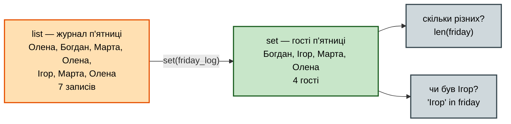
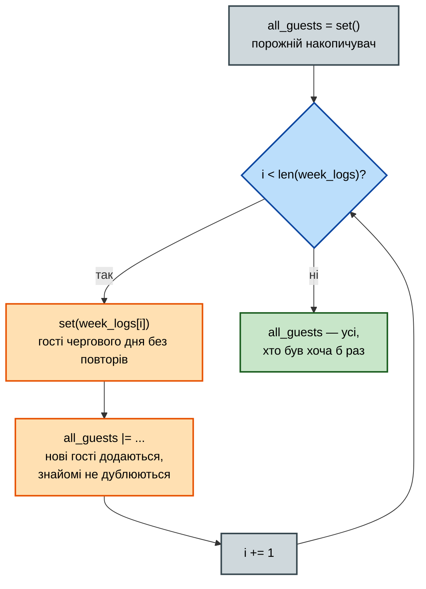
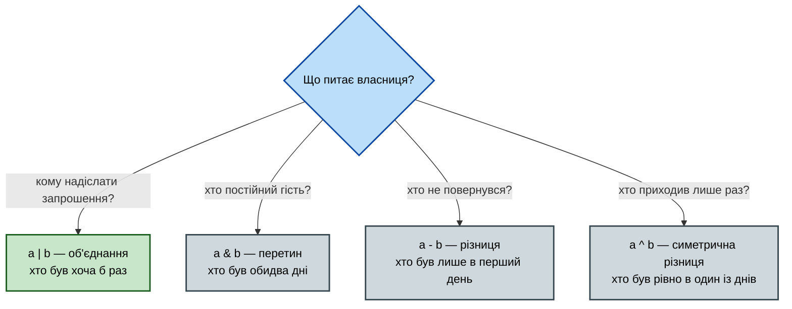

# Множини та їх об'єднання — Урок 5: гості кафе

> Окрема тема до розповіді заняття [`konspekt_lesson_05_cafe_story.ipynb`](konspekt_lesson_05_cafe_story.ipynb), схем [`restoran_alg.md`](restoran_alg.md) і книги ([урок 5](https://nikoriakviktor.github.io/PY-Course-Victor-Nikoriak-11-11-2026/modules/m1/lesson_05/)). Тільки `list`, `tuple` (+ `NamedTuple`), `set` і цикл `while`. Повний розбір усіх операцій над множинами — у бонусному ноутбуці [`set_docs.ipynb`](../../bonus/set_docs.ipynb), розділ 8.

## Завдання

Адміністраторка кафе щодня записує, хто з постійних гостей приходив. Після вихідних власниця питає:

1. Скільки **різних** гостей було за вихідні?
2. Кому надіслати запрошення на дегустацію — **усім, хто приходив хоча б раз**?

**Проблема, яку вирішуємо.** Записи ведуться списком, і одна людина трапляється в ньому кілька разів: Олена приходила в п'ятницю тричі, Марта була і в п'ятницю, і в суботу. Якщо просто склеїти списки, Олена отримає три запрошення, а Марта — три.

**Рішення.** Множина зберігає кожне значення один раз, а **об'єднання** множин збирає значення з кількох джерел і теж лишає кожне один раз.

```text
дані                →  структура       →  операція       →  результат
записи гостей          set                об'єднання  |     хто був хоча б раз
(списки з повторами)   без повторів       кілька джерел     кожен — один раз
```

---

# 1. Множина: що це і навіщо

Той самий запис п'ятниці — списком і множиною:

```python
friday_log = ["Олена", "Богдан", "Марта", "Олена", "Ігор", "Марта", "Олена"]

friday = set(friday_log)

print("список: ", friday_log)
print("множина:", sorted(friday))
print("записів у списку:", len(friday_log))
print("різних гостей:   ", len(friday))
```

```text
список:  ['Олена', 'Богдан', 'Марта', 'Олена', 'Ігор', 'Марта', 'Олена']
множина: ['Ігор', 'Богдан', 'Марта', 'Олена']
записів у списку: 7
різних гостей:    4
```

Список відповідає на запитання «**що і в якому порядку** записали». Множина — на запитання «**хто взагалі** був». Сім записів перетворилися на чотирьох гостей.



Схема показує, що множина — це не «інший список», а відповідь на інше запитання: порядок і кількість повторів зникають, залишається лише факт присутності.

| Властивість множини | Що це означає | Наслідок у коді |
|---|---|---|
| Унікальність | кожне значення зберігається один раз | `set(список)` прибирає повтори |
| Немає порядку | елементи не мають номерів | `friday[0]` — помилка; для друку використовуй `sorted(friday)` |
| Швидка перевірка | `in` не переглядає елементи по одному | `"Ігор" in friday` працює миттєво навіть на тисячах гостей |
| Тільки незмінні елементи | рядки, числа, кортежі — так; списки — ні | `{["кава", "чай"]}` — `TypeError` |

> **Чому в прикладах `sorted(...)`.** Порядок елементів у множині не гарантований: `print(friday)` на різних запусках може показати гостей по-різному. `sorted(friday)` повертає **список**, упорядкований за кодами символів, — вивід щоразу однаковий. Через ці коди «Ігор» опиняється перед «Богдан»: українська літера «І» стоїть у таблиці символів раніше за «А».

---

# 2. Об'єднання: що це

**Об'єднання** двох множин — нова множина з усіма елементами, які є **хоча б в одній** із них. Спільні елементи потрапляють у результат один раз.

```text
        п'ятниця                    субота
   ┌──────────────────────┐
   │  Олена    ┌──────────┼───────────────┐
   │  Богдан   │  Марта   │               │
   │           │  Ігор    │     Софія     │
   └───────────┼──────────┘               │
               └──────────────────────────┘

   об'єднання = усе, що всередині хоча б однієї рамки:
   Богдан, Ігор, Марта, Олена, Софія
```

```python
friday = {"Олена", "Богдан", "Марта", "Ігор"}
saturday = {"Марта", "Ігор", "Софія"}

weekend = friday | saturday

print("п'ятниця:  ", sorted(friday))
print("субота:    ", sorted(saturday))
print("об'єднання:", sorted(weekend))
print()
print("гостей у п'ятницю + у суботу:", len(friday) + len(saturday))
print("різних гостей за два дні:    ", len(weekend))
```

```text
п'ятниця:   ['Ігор', 'Богдан', 'Марта', 'Олена']
субота:     ['Ігор', 'Марта', 'Софія']
об'єднання: ['Ігор', 'Богдан', 'Марта', 'Олена', 'Софія']

гостей у п'ятницю + у суботу: 7
різних гостей за два дні:     5
```

Чотири плюс три — сім, але різних гостей п'ятеро: Марта й Ігор були обидва дні, і об'єднання порахувало їх по одному разу. Це і є відповідь на перше запитання власниці.

Самі множини `friday` і `saturday` при цьому **не змінилися** — `|` створює нову множину.

## Три способи записати об'єднання

| Запис | Що робить | Коли брати |
|---|---|---|
| `a \| b` | створює **нову** множину; з обох боків мають бути множини | обидва набори вже множини |
| `a.union(b, c, ...)` | створює **нову** множину; приймає і списки, і кортежі | дані приходять списком або наборів кілька |
| `a \|= b` або `a.update(b)` | **доповнює** множину `a` на місці, нової не створює | множина накопичується крок за кроком |

```python
friday = {"Олена", "Богдан", "Марта", "Ігор"}
saturday = {"Марта", "Ігор", "Софія"}

by_operator = friday | saturday
by_method = friday.union(saturday)

print("оператор |  :", sorted(by_operator))
print("метод union :", sorted(by_method))
print("результати однакові:", by_operator == by_method)
print("friday не змінилась:", sorted(friday))
```

```text
оператор |  : ['Ігор', 'Богдан', 'Марта', 'Олена', 'Софія']
метод union : ['Ігор', 'Богдан', 'Марта', 'Олена', 'Софія']
результати однакові: True
friday не змінилась: ['Ігор', 'Богдан', 'Марта', 'Олена']
```

---

# 3. Як об'єднання використовується в коді

## 3.1. Кілька джерел — один набір

Найчастіший випадок: є кілька наборів, потрібен один спільний. Об'єднувати можна скільки завгодно множин поспіль.

```python
friday = {"Олена", "Богдан", "Марта", "Ігор"}
saturday = {"Марта", "Ігор", "Софія"}
sunday = {"Ігор", "Софія", "Петро"}

all_guests = friday | saturday | sunday

print("усі гості за три дні:", sorted(all_guests))
print("запрошень на дегустацію:", len(all_guests))
print("те саме методом:", sorted(friday.union(saturday, sunday)) == sorted(all_guests))
```

```text
усі гості за три дні: ['Ігор', 'Богдан', 'Марта', 'Олена', 'Петро', 'Софія']
запрошень на дегустацію: 6
те саме методом: True
```

Це відповідь на друге запитання власниці: шість запрошень, кожному гостю одне.

## 3.2. Накопичення в циклі: порожня множина + `|=`

Днів може бути не три, а тридцять, і окремої змінної на кожен день ніхто не заводить — записи лежать у списку. Тоді множину **накопичують**: починають з порожньої і на кожному кроці доливають черговий день.

Порожня множина — це `set()`. Запис `{}` створює порожній **словник** (урок 6), а не множину.

```python
week_logs = [
    ["Олена", "Богдан", "Марта", "Олена", "Ігор", "Марта", "Олена"],   # п'ятниця
    ["Марта", "Ігор", "Софія", "Ігор"],                                  # субота
    ["Ігор", "Софія", "Петро", "Софія"],                                 # неділя
]

all_guests = set()                    # порожня множина-накопичувач

i = 0
while i < len(week_logs):
    all_guests |= set(week_logs[i])   # долити гостей чергового дня
    print(f"після дня {i + 1}: гостей {len(all_guests)} — {sorted(all_guests)}")
    i += 1
```

```text
після дня 1: гостей 4 — ['Ігор', 'Богдан', 'Марта', 'Олена']
після дня 2: гостей 5 — ['Ігор', 'Богдан', 'Марта', 'Олена', 'Софія']
після дня 3: гостей 6 — ['Ігор', 'Богдан', 'Марта', 'Олена', 'Петро', 'Софія']
```

Це той самий патерн «накопичувач», що й сума виторгу з `total += ...`, тільки замість числа накопичується множина, а замість `+=` стоїть `|=`.



Схема показує, що на кожному оберті в накопичувач потрапляють лише ті гості, яких там ще не було, — перевіряти це вручну не потрібно.

## 3.3. Дані приходять списком

Оператор `|` вимагає множини з обох боків. Методи `union()` і `update()` приймають і список — перетворювати його вручну не треба.

```python
regulars = {"Олена", "Марта"}
today_log = ["Ігор", "Марта", "Ігор", "Софія"]          # звичайний список з повторами

print("union зі списком:", sorted(regulars.union(today_log)))
print("regulars поки та сама:", sorted(regulars))

regulars.update(today_log)                               # доповнити саму множину
print("після update:", sorted(regulars))
```

```text
union зі списком: ['Ігор', 'Марта', 'Олена', 'Софія']
regulars поки та сама: ['Марта', 'Олена']
після update: ['Ігор', 'Марта', 'Олена', 'Софія']
```

## 3.4. Один елемент чи багато: `add` і `update`

`add` додає **одне** значення, `update` — **усі значення з набору**. Різницю найкраще видно на рядку.

```python
guests = {"Олена"}

guests.add("Богдан")                  # одне ім'я
print("add('Богдан'):         ", sorted(guests))

guests.update(["Марта", "Ігор"])      # кілька імен зі списку
print("update(['Марта','Ігор']):", sorted(guests))

letters = {"Олена"}
letters.update("Ігор")                # рядок — це набір літер!
print("update('Ігор'):        ", sorted(letters))
```

```text
add('Богдан'):          ['Богдан', 'Олена']
update(['Марта','Ігор']): ['Ігор', 'Богдан', 'Марта', 'Олена']
update('Ігор'):         ['І', 'Олена', 'г', 'о', 'р']
```

`update("Ігор")` розклав ім'я на літери, бо рядок — це послідовність символів. Одне ім'я додають через `add("Ігор")` або `update(["Ігор"])`.

## 3.5. Спільний довідник з двох частин

Об'єднання збирає не лише людей. Меню кухні й меню бару ведуть окремо, а касі потрібен один перелік усього, що можна замовити.

```python
kitchen_menu = {"борщ", "вареники", "деруни", "узвар"}
bar_menu = {"кава", "чай", "узвар", "лимонад"}

full_menu = kitchen_menu | bar_menu

print("усього позицій:", len(full_menu))
print(sorted(full_menu))
print("'узвар' у меню:", "узвар" in full_menu)
print("'піца' у меню: ", "піца" in full_menu)
```

```text
усього позицій: 7
['борщ', 'вареники', 'деруни', 'кава', 'лимонад', 'узвар', 'чай']
'узвар' у меню: True
'піца' у меню:  False
```

Узвар є і в кухні, і в барі, але в повному меню він один. Тепер перевірка замовлення — одне запитання `in` до однієї множини.

## 3.6. Об'єднання з чеків

Той самий список `orders` з уроку. Запитання: **хто з офіціантів працював у вихідні** (субота або неділя)? Збираємо множину для кожного дня і об'єднуємо.

```python
from typing import NamedTuple


class Order(NamedTuple):
    waiter: str
    total_bill: float
    tip: float
    day: str
    time: str
    size: int


orders = [
    Order("Тарас", 540.0, 50.0, "пт", "вечеря", 2),
    Order("Марія", 320.0, 30.0, "пт", "обід", 1),
    Order("Тарас", 980.0, 120.0, "сб", "вечеря", 4),
    Order("Олексій", 760.0, 70.0, "сб", "вечеря", 3),
    Order("Марія", 450.0, 0.0, "нд", "обід", 5),
]

saturday_staff = set()
sunday_staff = set()

i = 0
while i < len(orders):
    if orders[i].day == "сб":
        saturday_staff.add(orders[i].waiter)
    if orders[i].day == "нд":
        sunday_staff.add(orders[i].waiter)
    i += 1

weekend_staff = saturday_staff | sunday_staff

print("субота: ", sorted(saturday_staff))
print("неділя: ", sorted(sunday_staff))
print("вихідні:", sorted(weekend_staff))
```

```text
субота:  ['Олексій', 'Тарас']
неділя:  ['Марія']
вихідні: ['Марія', 'Олексій', 'Тарас']
```

---

# 4. Навіщо: те саме без множин

Спробуємо відповісти на запитання власниці самими списками.

**Спроба 1 — склеїти списки.**

```python
friday_log = ["Олена", "Богдан", "Марта", "Олена", "Ігор", "Марта", "Олена"]
saturday_log = ["Марта", "Ігор", "Софія", "Ігор"]

combined = friday_log + saturday_log

print(combined)
print("«гостей»:", len(combined))
print("запрошень для Олени:", combined.count("Олена"))
```

```text
['Олена', 'Богдан', 'Марта', 'Олена', 'Ігор', 'Марта', 'Олена', 'Марта', 'Ігор', 'Софія', 'Ігор']
«гостей»: 11
запрошень для Олени: 3
```

Одинадцять «гостей» і три запрошення Олені. Додавання списків нічого не знає про повтори.

**Спроба 2 — прибрати повтори вручну.**

```python
unique_guests = []

i = 0
while i < len(combined):
    if combined[i] not in unique_guests:      # кожна перевірка переглядає весь список
        unique_guests.append(combined[i])
    i += 1

print(unique_guests)
print("різних гостей:", len(unique_guests))
```

```text
['Олена', 'Богдан', 'Марта', 'Ігор', 'Софія']
різних гостей: 5
```

Працює, але це шість рядків, лічильник і перевірка `not in`, яка для кожного запису переглядає весь уже зібраний список.

**Те саме множинами:**

```python
weekend = set(friday_log) | set(saturday_log)

print(sorted(weekend))
print("різних гостей:", len(weekend))
print("той самий набір, що й вручну:", weekend == set(unique_guests))
```

```text
['Ігор', 'Богдан', 'Марта', 'Олена', 'Софія']
різних гостей: 5
той самий набір, що й вручну: True
```

| | Списки | Множини |
|---|---|---|
| Код | цикл `while`, лічильник, `if ... not in`, `append` | `set(a) \| set(b)` |
| Повтори | прибираємо самі — і можемо забути | не можуть з'явитися |
| Перевірка «чи вже є» | переглядає список елемент за елементом | миттєва, незалежно від розміру |
| Що читає людина | **як** це зроблено | **що** ми хочемо отримати |
| Порядок появи | зберігається | губиться |

Останній рядок — чесна ціна множини. Якщо важливо, **хто прийшов першим**, потрібен список. Якщо важливо лише, **хто був**, — множина.

---

# 5. Типові помилки

```python
friday = {"Олена", "Богдан"}

# 1. Оператор | зі списком
try:
    friday | ["Марта"]
except TypeError as error:
    print("1) friday | ['Марта'] → TypeError:", error)

# 2. Результат union() нікуди не зберегли
friday.union({"Марта"})
print("2) після friday.union({'Марта'}) без присвоєння:", sorted(friday))

# 3. Присвоїли результат update()
guests = {"Олена"}
guests = guests.update({"Ігор"})
print("3) guests = guests.update(...) →", guests)

# 4. {} — це не множина
print("4) type({}) →", type({}).__name__, "; type(set()) →", type(set()).__name__)

# 5. Індекс у множини
try:
    friday[0]
except TypeError as error:
    print("5) friday[0] → TypeError:", error)
```

```text
1) friday | ['Марта'] → TypeError: unsupported operand type(s) for |: 'set' and 'list'
2) після friday.union({'Марта'}) без присвоєння: ['Богдан', 'Олена']
3) guests = guests.update(...) → None
4) type({}) → dict ; type(set()) → set
5) friday[0] → TypeError: 'set' object is not subscriptable
```

| № | Помилка | Чому так | Як правильно |
|---|---|---|---|
| 1 | `friday \| ["Марта"]` | оператор працює лише з множинами | `friday \| {"Марта"}` або `friday.union(["Марта"])` |
| 2 | `friday.union(...)` без присвоєння | `union` створює нову множину, стару не чіпає | `weekend = friday.union(...)` або `friday.update(...)` |
| 3 | `guests = guests.update(...)` | `update` змінює множину на місці й повертає `None` | просто `guests.update(...)` |
| 4 | `guests = {}` | фігурні дужки без елементів — порожній словник | `guests = set()` |
| 5 | `friday[0]` | у множини немає порядку, отже й індексів | `sorted(friday)[0]` або `"Олена" in friday` |
| 6 | `update("Ігор")` | рядок розкладається на літери (розділ 3.4) | `add("Ігор")` |

---

# 6. Об'єднання серед інших операцій

Об'єднання відповідає на запитання «хто був **хоча б раз**». Для інших запитань — інші операції над тими самими множинами.

```python
friday = {"Олена", "Богдан", "Марта", "Ігор"}
saturday = {"Марта", "Ігор", "Софія"}

print("|  хоча б в один день:", sorted(friday | saturday))
print("&  в обидва дні:      ", sorted(friday & saturday))
print("-  лише в п'ятницю:   ", sorted(friday - saturday))
print("^  рівно в один день: ", sorted(friday ^ saturday))
print()
print("перевірка розміру:", len(friday), "+", len(saturday), "-", len(friday & saturday),
      "=", len(friday | saturday))
```

```text
|  хоча б в один день: ['Ігор', 'Богдан', 'Марта', 'Олена', 'Софія']
&  в обидва дні:       ['Ігор', 'Марта']
-  лише в п'ятницю:    ['Богдан', 'Олена']
^  рівно в один день:  ['Богдан', 'Олена', 'Софія']

перевірка розміру: 4 + 3 - 2 = 5
```

Останній рядок пояснює, чому 4 + 3 дало не 7: двох спільних гостей додавання порахувало двічі, тож їх один раз віднімаємо.



Схема показує, що операцію обирають за запитанням, а не за назвою: спершу сформулюй, кого саме треба знайти.

---

# 7. Перевір себе

**1.** Що надрукує код?

```python
a = {1, 2, 3}
b = {3, 4}
print(len(a | b))
```

<details><summary>Відповідь</summary><code>4</code>. У результаті <code>{1, 2, 3, 4}</code>: трійка є в обох множинах, але в об'єднанні вона одна.</details>

**2.** Після цього коду що лежить у `a`?

```python
a = {"кава"}
a.union({"чай"})
```

<details><summary>Відповідь</summary><code>{'кава'}</code>. <code>union</code> створив нову множину, але її нікуди не зберегли. Щоб змінити <code>a</code>, потрібен <code>a.update({"чай"})</code> або <code>a = a | {"чай"}</code>.</details>

**3.** Чому `orders_today = {}` — поганий початок для накопичення унікальних гостей?

<details><summary>Відповідь</summary>Це порожній словник, а не множина: у нього немає методу <code>add</code>, і <code>|=</code> з множиною дасть помилку. Потрібно <code>set()</code>.</details>

**4.** У кафе два зали. `hall_a = {"Олена", "Ігор"}`, `hall_b = ["Ігор", "Софія", "Софія"]`. Як одним рядком отримати всіх гостей без повторів?

<details><summary>Відповідь</summary><code>hall_a.union(hall_b)</code> — метод сам прийме список. Або <code>hall_a | set(hall_b)</code>.</details>

**5.** Коли об'єднання множин — **не** той інструмент?

<details><summary>Відповідь</summary>Коли важливі порядок або кількість повторів: черга замовлень, підрахунок, скільки разів приходила Олена. Множина ці відомості губить — тут потрібен список.</details>

## Спробуй сам

Є записи двох змін бариста: `morning = ["лате", "еспресо", "лате", "какао"]` і `evening = ["еспресо", "чай", "чай", "раф"]`.

1. Отримай множину всіх напоїв, які готували за день.
2. Порахуй, скільки різних напоїв було.
3. Зроби те саме накопиченням: порожня множина і цикл `while` по списку `[morning, evening]`.

<details><summary>Розв'язок</summary>

```python
morning = ["лате", "еспресо", "лате", "какао"]
evening = ["еспресо", "чай", "чай", "раф"]

drinks = set(morning) | set(evening)
print(sorted(drinks), len(drinks))        # ['еспресо', 'какао', 'лате', 'раф', 'чай'] 5

shifts = [morning, evening]
drinks_acc = set()
i = 0
while i < len(shifts):
    drinks_acc |= set(shifts[i])
    i += 1
print(drinks_acc == drinks)               # True
```

</details>

---

# Підсумок

- **Множина** зберігає кожне значення один раз і відповідає на запитання «хто взагалі є», а не «що і в якому порядку записали».
- **Об'єднання** `a | b` — нова множина з усім, що є хоча б в одній; спільні елементи не дублюються.
- `|` — коли обидва набори вже множини; `union()` — коли дані приходять списком; `|=` / `update()` — коли множина накопичується в циклі.
- Накопичувач завжди починається з `set()`, а не з `{}`.
- Об'єднання губить порядок і кількість повторів. Якщо вони потрібні — це задача для списку.

Далі: [`restoran_alg.md`](restoran_alg.md) — схеми всіх трьох контейнерів; [`set_docs.ipynb`](../../bonus/set_docs.ipynb), розділ 8 — усі математичні операції над множинами з властивостями й законами.
